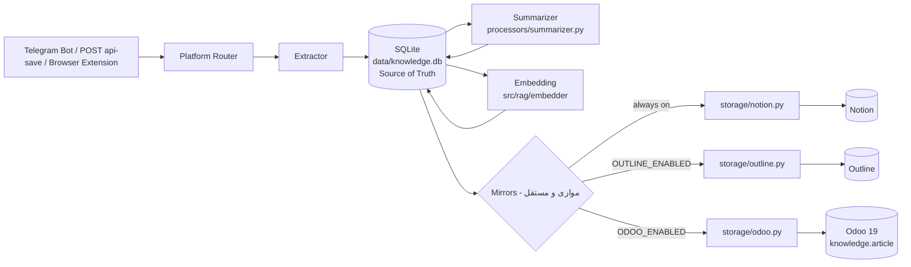
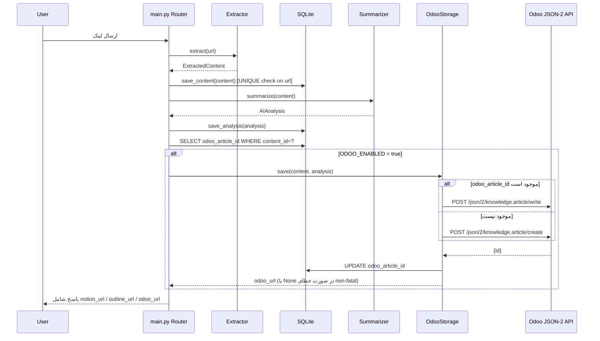

# PRD: اتصال Knowledge Agent به Odoo 19 Enterprise (Knowledge App)

> **نسخه سند:** 1.1 | **نویسنده:** Senior Solution Architect | **وضعیت:** Draft اصلاح‌شده بر اساس Discovery واقعی کدبیس و سرور

---

## Changelog (۱.۰ → ۱.۱)

| حوزه | تغییر |
|---|---|
| میزبانی | حذف فرض Odoo.sh؛ تأیید **self-hosted روی VPS** (`141.11.175.39:8069`)، نسخهٔ ایمیج `odoo:19.0-20250918`. محدودیت «پلن Custom» که مخصوص Odoo.sh/SaaS است، حذف شد. |
| ساختار ریپو (بخش ۰) | بازنویسی کامل بر اساس فایل‌های واقعی: `src/models/__init__.py` (نه `schemas.py`)، `src/processors/summarizer.py` (نه `src/summarizer/`)، کشف `src/storage/outline.py`، `src/rag/`، `src/processors/recovery.py`. |
| مدل داده | جایگزینی `KnowledgeItem` خیالی با دو آبجکت واقعی: `ExtractedContent` و `AIAnalysis`، و امضای واقعی `save(content, analysis) -> str \| None`. |
| معماری Storage | حذف کامل مدل «Storage Abstraction با سوئیچ `STORAGE_BACKEND`»؛ جایگزینی با معماری واقعی: **SQLite به‌عنوان منبع حقیقت** + سه آینهٔ انتشار (Notion, Outline, Odoo) با الگوی `*_ENABLED` و try/except غیرمخرب. |
| Dedup | حذف فرض فیلد سفارشی `x_source_url` روی Odoo؛ تأیید که `article_url` در Odoo `store=false` و `readonly` است و قابل استفاده برای Dedup نیست. Dedup واقعی از `content.url UNIQUE` در SQLite می‌آید. |
| تگ‌گذاری و Metadata | حذف فرض «تگ در body»؛ جایگزینی با استفاده از فیلد واقعی و موجود `article_properties` (Properties، stored) — بدون نیاز به ماژول سفارشی یا Odoo Studio. |
| مجوزدهی | افزودن واقعیت `knowledge.article.member`، `internal_permission`، `is_article_visible_by_everyone`، `inherited_permission`؛ حذف فیلد خیالی `is_article_visible_by_default`. |
| FR-011 | **Dropped** — سوئیچ `STORAGE_BACKEND` با معماری Multi-mirror واقعی همخوانی ندارد؛ جایگزین با الگوی `ODOO_ENABLED`. |
| فاز ۲ | افزوده شدن مسیر مهاجرت بردار/گراف به **schema جدا (`ka`) در همان کلاستر Postgres اودو + pgvector**، با نیاز به تعویض ایمیج از `postgres:16` به `pgvector/pgvector:pg16`. افزودن طراحی Knowledge Graph (`kg_nodes`, `kg_edges`). |
| Open Questions | Q1 تا Q3 بسته شدند (پاسخ داده شده)؛ Q4 تا Q8 باز ماندند؛ یک سؤال جدید دربارهٔ مهاجرت کامل در برابر منابع موازی در فاز ۲ اضافه شد. |
| خروجی | افزودن جدول خلاصهٔ «حذف‌شده / اصلاح‌شده / اضافه‌شده» در پایان سند. |

---

## ۰. یافته‌های Discovery از ریپو (اصلاح‌شده بر اساس بررسی واقعی کد)

مسیر ریپو: `/root/knowledge-agent-repo`

### جدول «فایل → نقش واقعی»

| فایل/مسیر | نقش واقعی |
|---|---|
| `src/main.py` | Entry point FastAPI؛ ارکستراسیون کامل جریان: Extract → SQLite save → Summarize → SQLite save → Embedding → Notion → Outline (اختیاری) |
| `src/models/__init__.py` | تعریف مدل‌های داده واقعی: `ExtractedContent` و `AIAnalysis` (جزئیات در بخش ۴/۷) |
| `src/processors/summarizer.py` | منطق خلاصه‌سازی با AI (نه `src/summarizer/summarizer.py` همان‌طور که در ۱.۰ فرض شده بود) |
| `src/processors/recovery.py` | زیرساخت موجود برای بازیابی خطا و مدیریت سهمیه (Quota) — باید برای Retry/DLQ آینهٔ Odoo هم استفاده شود، نه ماژول جدید |
| `src/storage/__init__.py` | فقط `NotionStorage` را export می‌کند |
| `src/storage/notion.py` | پیاده‌سازی آینهٔ Notion؛ امضای `async def save(self, content: ExtractedContent, analysis: AIAnalysis) -> str \| None` |
| `src/storage/outline.py` | پیاده‌سازی آینهٔ Outline؛ **بهترین الگوی کپی برای `odoo.py`** (ساخت بدنه از content+analysis، بازگشت URL، فعال‌سازی با env، خطای non-fatal) |
| `src/storage/concepts.py` | منطق مرتبط با مفاهیم استخراج‌شده (concepts) |
| `src/rag/` | شامل `chunker`, `embedder`, `vector_store`, `rag_engine` — زیرساخت RAG موجود که در فاز ۲ برای جست‌وجوی ترکیبی استفاده می‌شود |
| `src/render/` | UI وب موجود پروژه |
| `data/knowledge.db` | **منبع حقیقت (Source of Truth)** — SQLite با جداول `content` (ستون `url` با قید `UNIQUE`)، `doc_versions`، `embeddings` (بردار float32 با ۳۸۴ بعد از مدل e5-small)، `concepts` (`norm`, `display`, `doc_count`, `doc_ids`) |
| `docs/adr/` | پوشهٔ Architecture Decision Records، از قبل موجود در ریپو |
| `requirements.txt` | شامل `lxml` و `markdown-it-py`؛ **`bleach` نه اعلام شده و نه هیچ‌جا import می‌شود — برای این پروژه لازم نیست** (تبدیل Markdown→HTML با `markdown-it-py` انجام می‌شود). شکاف واقعی وابستگی‌ها: `playwright`، `youtube_transcript_api` و `socketio` در کد import می‌شوند ولی اعلام/نصب نشده‌اند (تفصیل در تکمیل Discovery پایان همین بخش) |

### جریان واقعی فعلی (`src/main.py`)

```
Extract → sqlite_store.save_content()
       → Summarize (processors/summarizer.py)
       → sqlite_store.save_analysis()
       → embedding (src/rag/embedder)
       → Notion (storage/notion.py)
       → Outline (اختیاری، OUTLINE_ENABLED)
       → پاسخ به کاربر شامل notion_url / outline_url
```

این جریان نشان می‌دهد که **SQLite نقطهٔ مرکزی ذخیره‌سازی است، نه Notion**؛ Notion و Outline صرفاً «آینه‌های انتشار» (Publishing Mirrors) هستند که محتوا را از روی داده‌ی موجود در SQLite می‌سازند. بر این اساس، Odoo نیز باید به همین الگو — یک آینهٔ سوم با پرچم فعال/غیرفعال و خطای غیرمخرب — اضافه شود، نه یک «Storage Backend قابل سوئیچ».

### وضعیت سرور Odoo هدف (تأیید‌شده)

- Odoo 19 Enterprise self-hosted، آدرس `141.11.175.39:8069`، ایمیج `odoo:19.0-20250918` (هم‌نسخه با بستهٔ Enterprise).
- ماژول `knowledge` نصب است.
- تست دستی `POST /json/2/knowledge.article/search_read` بدون کلید پاسخ **401** داده (یعنی endpoint JSON-2 فعال و در دسترس است).
- مسیر قدیمی `/jsonrpc` نیز پاسخ می‌دهد اما **deprecated** است؛ هدف توسعه باید منحصراً JSON-2 باشد.
- بررسی مستقیم `ir_model_fields` روی مدل `knowledge.article` فیلدهای واقعی را تأیید کرده (بخش ۷).
- هیچ فیلد `x_*` سفارشی روی مدل تعریف نشده است.

### تکمیل Discovery — Task 1 (۲۰۲۶-۱۱-۰۴)

بررسی کاملِ کد بی‌واسطه (مدل‌ها، دو آینهٔ موجود، پیکربندی، وابستگی‌ها) روی همین نسخهٔ ریپو انجام شد.
سند کامل: `docs/task-1-repo-discovery.md`. یافته‌های تازه‌ای که این PRD را اصلاح می‌کنند:

1. **`SaveResponse` نیازمند `odoo_url` است.** کلاس فعلی در `src/models/__init__.py` فقط `notion_url` / `outline_url` / `affine_url` را برمی‌گرداند؛ بدون افزودن `odoo_url`، لینک آینهٔ جدید به کاربر/API نمی‌رسد. `affine_url` کلید مرده است.
2. **`SetupRequest` / `SetupResponse` کلاس‌های مرده‌اند** (بدون هیچ مصرف‌کننده — `POST /api/setup` حذف شده است) و باید بازنشسته شوند.
3. **۵ نقطهٔ تماس** باید آینهٔ Odoo را صدا بزنند، نه یکی: `main.py` (۱ نقطه) + `telegram_bot.py` (۴ نقطه شامل شاخهٔ لینک تکراری). هر نقطه با گیت `*_ENABLED` و `try/except` غیرمخرب — هم‌الگوی دقیق `_save_outline`.
4. **الگوی نهایی آینه: `storage/outline.py`** (sync + `asyncio.to_thread` + گیت فعال‌سازی + بدنهٔ ساخته‌شده از `content+analysis`)، نه `notion.py` (async httpx بدون گیت).
5. **`bleach` لازم نیست** (نه اعلام شده، نه import می‌شود). شکاف واقعی وابستگی: `socketio` (top-level و unguarded در `storage/affine.py`) و `playwright` / `youtube_transcript_api` (هر دو داخل `try/except ImportError`). برای آینهٔ Odoo هیچ وابستگی جدیدی لازم نیست.
6. **وضعیت زندهٔ امروز:** `/health` مقدار `notion:false` می‌دهد و Outline فعال نیست — یعنی SQLite امروز تنها مقصد زنده است. مسیر ذخیرهٔ Odoo باید در همین شرایط (هیچ آینهٔ فعالی) هم کامل سالم بماند.
7. **گیت فعال‌سازی باید `ODOO_ENABLED` باشد** و کلیدهای جدید (`odoo_url`, `odoo_db`, `odoo_api_key`, `odoo_enabled`) با مقدار پیش‌فرض به `src/config.py` اضافه شوند؛ `extra="ignore"` است پس افزودن‌شان boot را نمی‌شکند.

### تکمیل Discovery — Task 2 (۲۰۲۶-۱۱-۰۴) — شِیپ واقعی JSON-2

کلید API روی همین instance ساخته و همهٔ فراخوانی‌ها با کد HTTP واقعی تست شدند. سند کامل: `docs/task-2-odoo-json2-api-key.md`.

- **`create` فقط `vals_list` می‌پذیرد:** `{"vals": …}` → **422** `missing a required argument: 'vals_list'`؛ شکل درست `{"vals_list": [{…}]}` → **200** `[id]`. (این نکته در هیچ‌جای PRD قبلی نبود.)
- **shape نهایی:** `search_read {domain, fields, limit, order}` · `search_count {domain}` · `read {ids, fields}` · `write {ids, vals}` · `unlink {ids}` — همه با `POST /json/2/<model>/<method>` و هدر `Authorization: bearer <key>`.
- **خطاهای احراز هویت تفکیک‌پذیرند:** بدون کلید → 401 `User not authenticated…`؛ کلید غلط → 401 `Invalid apikey`.
- **`NFR-002` تجربی اثبات شد:** `create` با `internal_permission='none'` و بدون عضو → **422** `needs at least one member with 'Write' access`. راه‌حل یک‌تماسی تأییدشده: `article_member_ids: [[0,0,{"partner_id": P, "permission": "write"}]]` در همان `create` (تست شد: 200 و ثبت عضو، و بعد از `unlink` هیچ زباله‌ای نماند).
- **`article_url` واقعاً `store=False, readonly=True` است** (از `fields_get`): خوانده می‌شود ولی فیلتر نمی‌شود → تأیید قطعی اینکه Dedup از آن ممکن نیست.
- **`read` روی id ناموجود** ردیفی از `false`ها برمی‌گرداند، نه لیست خالی → کلاینت باید مقدار `id` را چک کند.
- **`body` اگر خالی بماند** به‌طور پیش‌فرض `<h1>{name}</h1>` می‌شود؛ و `icon` نوع char است (نه selection).
- کلید موقت برای `admin` (uid 2) در `/root/odoo/.ka_api_key` (chmod 600، انقضا ۹۰ روز، scope `rpc`) قرار گرفت و در T3 با کلید کاربر سرویس جایگزین می‌شود.

---

## ۱. خلاصهٔ اجرایی

### Problem Statement
Knowledge Agent در حال حاضر خروجی Pipeline خود (Extraction → Summarization) را در SQLite محلی ذخیره و سپس به‌صورت آینه در Notion (و اختیاری Outline) منتشر می‌کند. سازمان می‌خواهد Odoo 19 Enterprise self-hosted را به‌عنوان یک کانال انتشار/مشاهدهٔ سازمانی دیگر برای این دانش اضافه کند، بدون آنکه معماری فعلی مبتنی بر SQLite به‌عنوان Source of Truth مختل شود.

### Goals
- G1: افزودن Odoo (`knowledge.article`) به‌عنوان **آینهٔ انتشار سوم**، در کنار Notion و Outline، با همان الگوی `*_ENABLED` و خطای غیرمخرب.
- G2: حفظ کامل جریان فعلی Pipeline (Extraction، Summarization، SQLite) بدون تغییر در منطق بالادستی.
- G3 (اصلاح‌شده): پیاده‌سازی **الگوی آینهٔ چندگانه (Multi-mirror Pattern)** هم‌راستا با `storage/outline.py` موجود؛ طراحی یک Interface مشترک رسمی (`StorageBackend`) **اختیاری و موکول به فاز ۲** است، نه پیش‌نیاز MVP.
- G4: Migration یک‌باره و امن داده‌های موجود از Notion (یا SQLite) به Odoo برای رکوردهای تاریخی.
- G5: استفاده از ساختار درختی، `article_properties`، و مدل مجوزدهی بومی Odoo بدون نیاز به ماژول سفارشی.

### Non-goals
- بازنویسی کامل Extractor ها یا Summarizer.
- تغییر SQLite از جایگاه منبع حقیقت یا جایگزینی آن با Odoo.
- **نوشتن مستقیم SQL در جدول‌های دیتابیس Postgres اودو** (ممنوع در تمام فازها؛ هرگونه نوشتن در Odoo فقط از طریق JSON-2 API مجاز است).
- ساخت ماژول Odoo سفارشی یا استفاده از Odoo Studio برای افزودن فیلد.
- پیاده‌سازی کامل Knowledge Graph/pgvector در فاز ۱ (موکول به فاز ۲ با scope جدا).
- تغییر در زیرساخت Telegram Bot یا Browser Extension.

---

## ۲. Stakeholders و Personas

| نقش | توضیح | نیازها |
|---|---|---|
| **کاربر نهایی (Knowledge Worker)** | کسی که لینک را ارسال می‌کند و بعداً دانش را در Odoo می‌خواند | ذخیره‌سازی سریع، دسته‌بندی خودکار، جستجوی آسان، محتوای فارسی/انگلیسی خوانا |
| **ادمین Odoo** | مسئول پیکربندی Workspace، عضویت کاربر سرویس، `internal_permission` | کنترل دسترسی، مدیریت API Key، گزارش خطا |
| **DevOps / Platform Engineer** | مسئول Deploy، مانیتورینگ VPS، بکاپ دیتابیس Odoo/Postgres | Observability، Secrets Management، Rollback ساده |
| **صاحب محصول (Product Owner)** | تصمیم‌گیرنده نهایی روی فازبندی، استراتژی Notion، سطح دسترسی | KPI، ریسک، هزینه |

---

## ۳. User Stories با Acceptance Criteria

### US-1: ذخیرهٔ خودکار خلاصهٔ یک مقالهٔ ArXiv در Odoo
```
Given کاربری لینک یک مقاله ArXiv را ارسال می‌کند
When Extraction و Summarization با موفقیت در SQLite ثبت می‌شود و ODOO_ENABLED=true است
Then یک رکورد جدید در knowledge.article زیر parent متناظر با platform="arxiv" ایجاد می‌شود
And فیلد name برابر content.title و body شامل خلاصه + full_text است
And شناسهٔ مقالهٔ Odoo در SQLite (ستون آینهٔ Odoo) ذخیره می‌شود
```

### US-2: جلوگیری از رکورد تکراری (اصلاح‌شده)
```
Given content.url از قبل در جدول content با قید UNIQUE ثبت شده است
When همان URL دوباره پردازش می‌شود
Then SQLite از ابتدا جلوی ایجاد رکورد تکراری در content را می‌گیرد (قید UNIQUE)
And اگر رکورد آینهٔ Odoo قبلاً برای این content ساخته شده، شناسهٔ آن از SQLite خوانده و write به Odoo اجرا می‌شود، نه create جدید
And جست‌وجو در خود Odoo (search_read) فقط برای بازیابی id در صورت نبود آن در SQLite (مثلاً پس از Migration دستی) لازم است
```

### US-3: دسته‌بندی خودکار بر اساس نوع منبع (اصلاح‌شده)
```
Given content.platform برابر "youtube" است
When مقاله در Odoo ساخته می‌شود
Then parent_id آن برابر شناسهٔ واقعی مقالهٔ والد "YouTube" (ذخیره‌شده در ODOO_PARENT_YOUTUBE_ID یا کش SQLite) است
And اگر والد وجود نداشته باشد، به‌صورت idempotent در Odoo ساخته و شناسه‌اش در SQLite کش می‌شود
```

### US-4: محتوای فارسی و ترکیبی
```
Given analysis.summary_fa متن فارسی (RTL) و content.full_text شامل اصطلاحات انگلیسی (LTR) است
When محتوا در body (HTML) ذخیره می‌شود
Then جهت متن در ادیتور Knowledge به‌درستی RTL نمایش داده می‌شود
And عبارات انگلیسی داخل متن به‌هم‌ریخته یا بریده نمی‌شوند
```

### US-5: Migration یک‌باره
```
Given رکوردهای موجود در جدول content و analysis در SQLite (یا به‌صورت جایگزین، دیتابیس Notion)
When اسکریپت Migration اجرا می‌شود
Then تمام رکوردها (یا زیرمجموعهٔ فیلترشده) به Odoo منتقل می‌شوند، با رعایت قید Dedup از SQLite
And گزارش نهایی شامل تعداد موفق/ناموفق/skipped تولید می‌شود
And اجرای مجدد اسکریپت idempotent است
```

### US-6 (فاز ۲): جستجوی دانش ترکیبی (Vector + Graph)
```
Given کاربر عبارت جستجو را ارسال می‌کند
When درخواست به موتور RAG (src/rag/rag_engine) با پشتیبانی schema جدید ka ارسال می‌شود
Then نتایج بر اساس vector top-k، سپس یک گام گسترش در Knowledge Graph (kg_nodes/kg_edges) و rerank نهایی برگردانده می‌شود
And هر نتیجه در صورت وجود، شامل لینک مستقیم به مقالهٔ متناظر در Odoo است
```

---

## ۴. Functional Requirements

### دسته A: Core Mirror Integration

| ID | شرح | معیار پذیرش قابل‌تست |
|---|---|---|
| **FR-001** | سیستم باید بتواند با فراخوانی `OdooStorage.save(content, analysis)` یک رکورد `knowledge.article` از طریق `POST /json/2/knowledge.article/create` ایجاد کند. API Key باید از مسیر **Preferences > Account Security** در خود Odoo ساخته شود و هدر `Authorization: bearer <API_KEY>` ارسال شود | فراخوانی به سرور واقعی (`141.11.175.39:8069`) با کلید معتبر باید HTTP 200 و id معتبر بازگرداند؛ بدون کلید باید 401 بگیرد (مطابق تست انجام‌شده) |
| **FR-002** | نگاشت فیلدها طبق جدول بخش ۷ (فیلدهای واقعی) باید دقیقاً پیاده‌سازی شود: `content.title → name`، `analysis.summary_fa + analysis.summary_en + content.full_text → body`، `content.url → article_properties.source_url`، `content.platform → parent_id`، `analysis.tags → article_properties.tags` | تست Unit مقایسهٔ payload خروجی با مقادیر واقعی `ExtractedContent`/`AIAnalysis` ورودی |
| **FR-003** | محتوای Markdown (خروجی `processors/summarizer.py`) باید با استفاده از `markdown-it-py` (موجود در `requirements.txt`) به HTML معتبر تبدیل و برای سازگاری با ادیتور Knowledge آماده شود | خروجی تابع تبدیل باید HTML معتبر (قابل parse با `lxml`، که در `requirements.txt` موجود است) تولید کند |
| **FR-004** | مقالات باید بر اساس `content.platform` زیر یک parent مشخص (ArXiv/YouTube/Web/Telegram/...) دسته‌بندی شوند | رکورد ساخته‌شده باید `parent_id` برابر id مقالهٔ والد متناظر با platform داشته باشد |
| **FR-005** | اگر مقالهٔ والد برای یک platform در Odoo وجود نداشته باشد، سیستم باید آن را خودکار بسازد (Lazy creation) و id آن را **در SQLite** (جدول کمکی کش والدین، نه فایل جانبی) ذخیره کند | در اولین اجرا برای platform جدید، یک رکورد والد در SQLite و Odoo ساخته می‌شود؛ در اجرای بعدی از کش SQLite خوانده می‌شود |
| **FR-006** (اصلاح‌شده) | Dedup باید از `content.url` با قید `UNIQUE` در SQLite انجام شود، نه از کوئری روی Odoo. چون فیلد `article_url` در Odoo `store=false` و `readonly` است و **قابل استفاده برای Dedup نیست** | تلاش برای درج دوبارهٔ همان URL در جدول `content` باید توسط SQLite رد شود؛ هیچ فراخوانی `search_read` برای این منظور لازم نیست |
| **FR-007** (اصلاح‌شده) | اگر رکورد برای یک `content.id` از قبل شناسهٔ آینهٔ Odoo در SQLite داشته باشد، عملیات `write` اجرا شود؛ `search_read` در Odoo فقط به‌عنوان Fallback برای بازیابی id در صورت نبود آن در SQLite (مثلاً داده‌های Migration‌شده) استفاده شود | تست: وجود `odoo_article_id` در SQLite → فراخوانی `write`؛ نبود آن → یک‌بار `search_read` روی `article_properties.source_url`، سپس `create` یا `write` بسته به نتیجه |
| **FR-008** | محتوای HTML تولیدشده باید ویژگی جهت متن (`dir="rtl"` یا کلاس معادل) را برای پاراگراف‌های فارسی به‌صورت خودکار تشخیص و اعمال کند | تست با ورودی فارسی خالص، فارسی+انگلیسی ترکیبی، انگلیسی خالص؛ خروجی HTML باید جهت صحیح per-paragraph داشته باشد |
| **FR-009 (فاز ۲)** | باید قابلیت جستجوی ترکیبی (vector + graph) از طریق `src/rag/rag_engine` فراهم شود که در صورت وجود، لینک مقالهٔ متناظر در Odoo را هم برگرداند | کوئری نمونه باید ظرف ۳ ثانیه نتیجه برگرداند و در صورت وجود mapping، لینک Odoo را شامل شود |
| **FR-010** | اسکریپت Migration یک‌باره باید رکوردهای موجود (SQLite یا Notion) را خوانده و از طریق همان مسیر `OdooStorage.save()` به Odoo منتقل کند، با رعایت Dedup از SQLite | اجرای اسکریپت روی نمونهٔ داده باید رکوردهای متناظر (منهای duplicateهای شناسایی‌شده توسط SQLite) را در Odoo ایجاد و گزارش تولید کند |
| **FR-011** | **Dropped.** دلیل: سوئیچ `STORAGE_BACKEND=notion\|odoo\|dual` با معماری واقعی (SQLite به‌عنوان Source of Truth + چند آینهٔ مستقل) همخوانی ندارد. جایگزین: متغیر `ODOO_ENABLED` دقیقاً مطابق الگوی موجود `OUTLINE_ENABLED` در `storage/outline.py`، که آینهٔ Odoo را مستقل و موازی با Notion/Outline فعال/غیرفعال می‌کند، بدون نیاز به انتخاب انحصاری بین backendها |
| **FR-012** | تمام attachment/تصاویر استخراج‌شده باید به‌صورت `ir.attachment` با `res_model='knowledge.article'` و `res_id` برابر id رکورد مرتبط ذخیره شوند | آپلود یک تصویر نمونه باید رکورد attachment قابل مشاهده در تب Attachments مقاله در Odoo ایجاد کند |

### دسته B: پیکربندی و تگ‌گذاری (اصلاح‌شده)

| ID | شرح | معیار پذیرش |
|---|---|---|
| **FR-013** (اصلاح‌شده) | `analysis.tags` و `content.url` باید در فیلد واقعی و موجود **`article_properties`** (نوع Properties، `store=true`) ذخیره شوند، نه در متن body. این فیلد نیازی به ماژول سفارشی یا Odoo Studio ندارد چون از قبل روی مدل تعریف شده است | بررسی مستقیم رکورد ساخته‌شده در Odoo: `article_properties` باید شامل کلیدهای `source_url` و `tags` با مقادیر صحیح باشد |
| **FR-014** | تاریخ (`content.published_date` یا زمان پردازش) باید در `article_properties` (کلید `source_date`) ذخیره شود؛ چون `knowledge.article` فیلد اختصاصی تاریخ منبع ندارد | رکورد ساخته‌شده باید کلید `source_date` در `article_properties` داشته باشد |
| **FR-015** (اصلاح‌شده) | هر مقاله باید یک مقدار برای فیلد واقعی **`icon`** (Char/Emoji) بر اساس `content.platform` دریافت کند | فیلد `icon` رکورد ساخته‌شده برابر مقدار mapping جدول بخش ۷ باشد؛ درج در body ممنوع است |

---

## ۵. Non-Functional Requirements

| ID | دسته | الزام | معیار پذیرش |
|---|---|---|---|
| **NFR-001** | امنیت | `ODOO_API_KEY` هرگز نباید در لاگ، کد یا پیام خطا چاپ شود | Code review + تست grep روی لاگ‌های تولیدشده |
| **NFR-002** (اصلاح‌شده) | امنیت/مجوزدهی | صرفِ داشتن دسترسی Create/Write روی مدل `knowledge.article` کافی نیست. کاربر سرویس باید علاوه بر این، عضو Workspace مقصد باشد (از طریق `knowledge.article.member`) و با توجه به `internal_permission` رکورد والد، دسترسی لازم را داشته باشد؛ در غیر این صورت مقاله ساخته می‌شود ولی برای سایر اعضا دیده نمی‌شود | تست: ساخت مقاله با کاربر سرویسی که عضو Workspace نیست → بررسی که رکورد در دیتابیس ساخته شده اما در UI برای کاربر دیگر قابل مشاهده نیست؛ سپس افزودن عضویت و تکرار تست برای تأیید رفع مشکل |
| **NFR-003** | امنیت | API Key باید دارای Expiration Date باشد و فرآیند Rotation مستند شود (از همان صفحهٔ Preferences > Account Security که در FR-001 اشاره شد) | چک‌لیست Rotation هر ۹۰ روز تعریف و تست دستی شود |
| **NFR-004** | Rate Limiting | درخواست‌ها به Odoo API نباید از X req/sec (قابل‌تنظیم، پیش‌فرض ۵) بیشتر شوند، با توجه به اینکه سرور self-hosted منابع محدود VPS را دارد | تست Load با Burst درخواست؛ Rate limiter محلی (token bucket) پیاده‌سازی شود |
| **NFR-005** | Reliability | هر فراخوانی API باید حداکثر ۳ بار با Exponential Backoff Retry شود، فقط برای خطاهای Transient (5xx, timeout, network)؛ این منطق باید **روی زیرساخت موجود `src/processors/recovery.py` سوار شود**، نه ماژول جدید و مستقل | شبیه‌سازی خطای 503 باید از طریق `recovery.py` با همان الگوی مدیریت سهمیه/خطا، ۳ تلاش با فاصلهٔ افزایشی ثبت کند |
| **NFR-006** | Idempotency | عملیات create/write باید idempotent باشند (ارسال مجدد همان payload نباید رکورد تکراری در Odoo بسازد)، با تکیه بر Dedup مبتنی بر SQLite (FR-006/007) | تست اجرای دوبارهٔ `save()` با همان `content.url` |
| **NFR-007** | Observability | هر فراخوانی Odoo API باید با Structured Log (JSON) شامل `request_id`, `model`, `method`, `status`, `duration_ms` ثبت شود؛ این لاگ‌گیری باید با الگوی موجود مدیریت خطا در `processors/recovery.py` هماهنگ باشد | بررسی خروجی لاگ در Docker logs / فایل |
| **NFR-008** | Performance | میانگین زمان ذخیرهٔ یک آیتم در آینهٔ Odoo (پس از ثبت موفق در SQLite) باید کمتر از ۳ ثانیه (بدون احتساب شبکهٔ کند بین سرور Agent و VPS Odoo) باشد | اندازه‌گیری P50/P95 در تست Load |
| **NFR-009** | سازگاری نسخه | کد باید صراحتاً JSON-2 API (`/json/2/...`) را هدف قرار دهد. بر روی سرور هدف، این endpoint **تأیید شده فعال است** (پاسخ 401 بدون کلید در تست انجام‌شده)؛ مسیر قدیمی `/jsonrpc` deprecated است و نباید در مسیر اصلی استفاده شود | Code review: هیچ import از `xmlrpc.client` یا فراخوانی `/jsonrpc` در مسیر اصلی وجود نداشته باشد |
| **NFR-010** (اصلاح‌شده) | قابلیت نگهداری | طراحی یک Interface رسمی مشترک (`StorageBackend`) برای یکسان‌سازی آینه‌ها **اختیاری و موکول به فاز ۲** است. در فاز ۱ (MVP)، `odoo.py` باید دقیقاً از الگوی ساختاری `storage/outline.py` موجود (تابع `save(content, analysis)`، فعال‌سازی با env، خطای non-fatal) پیروی کند، بدون نیاز به یک Abstract Base Class جدید | بررسی کد: امضای تابع و ساختار فایل `storage/odoo.py` باید با `storage/outline.py` قابل‌مقایسه و هم‌الگو باشد |

---

## ۶. معماری پیشنهادی (بازنویسی کامل)

### ۶.۱ طراحی Multi-mirror (SQLite به‌عنوان Source of Truth)

برخلاف فرض ۱.۰ (سوئیچ انحصاری بین backendها)، معماری واقعی به این صورت است:

- **SQLite (`data/knowledge.db`)** تنها منبع حقیقت است؛ تمام محتوا، تحلیل، embedding و concepts ابتدا اینجا ذخیره می‌شوند.
- **Notion، Outline و اکنون Odoo** هر سه «آینهٔ انتشار» (Publishing Mirror) مستقل هستند که از روی داده‌ی SQLite ساخته می‌شوند.
- هر آینه با یک پرچم env (`OUTLINE_ENABLED`, `ODOO_ENABLED`) مستقلاً فعال/غیرفعال می‌شود و خطای هر آینه **non-fatal** است؛ یعنی شکست در نوشتن به Odoo نباید جریان اصلی (ذخیرهٔ SQLite، Notion) را متوقف کند.
- یک Interface رسمی مشترک بین آینه‌ها (`StorageBackend` انتزاعی) **در فاز ۱ ساخته نمی‌شود**؛ هر آینه امضای یکسان `save(content, analysis) -> str | None` را عملاً (نه از طریق ارث‌بری رسمی) رعایت می‌کند، دقیقاً مانند الگوی موجود `outline.py`. تعریف رسمی Interface به فاز ۲ موکول شده است (NFR-010).

```python
# src/storage/odoo.py (فایل جدید - هم‌الگو با outline.py)
class OdooStorage:
    def __init__(self, url: str, api_key: str, timeout: int, max_retries: int):
        ...

    async def save(self, content: ExtractedContent, analysis: AIAnalysis) -> str | None:
        """
        ۱. بررسی SQLite برای odoo_article_id موجود (FR-006/007)
        ۲. در صورت نبود، get_or_create_parent(content.platform) (FR-004/005)
        ۳. ساخت payload: name, body(HTML), icon, article_properties (FR-002/013/014/015)
        ۴. create یا write از طریق JSON-2 API (FR-001)
        ۵. ذخیرهٔ id بازگشتی در SQLite
        ۶. خطا → non-fatal، لاگ از طریق processors/recovery.py (NFR-005/007)
        """
```

### ۶.۲ دیاگرام جریان داده (Mermaid)



### ۶.۳ دیاگرام توالی (Sequence Diagram)



### ۶.۴ مقایسهٔ دو رویکرد معماری (حفظ‌شده با نتیجه‌گیری اصلاح‌شده)

| معیار | (الف) سرویس خارجی (آینهٔ `odoo.py` با JSON-2) | (ب) ماژول سفارشی Odoo (Custom Addon) |
|---|---|---|
| سرعت توسعه | سریع؛ کپی مستقیم از الگوی `outline.py` موجود | کندتر؛ نیاز به دانش Odoo module dev و نصب ماژول روی سرور production |
| وابستگی به پلن | بدون محدودیت پلن (self-hosted، نه Odoo.sh) | بدون این محدودیت هم |
| نیاز به فیلد سفارشی | **عدم نیاز** — `article_properties` از قبل موجود و stored است و کفایت می‌کند | امکان تعریف فیلد دلخواه، اما بدون نیاز واقعی در این مورد |
| تناسب با معماری فعلی ریپو | بسیار بالا — کاملاً هم‌راستا با الگوی Multi-mirror موجود (`outline.py`) | نیاز به دو Codebase جدا (Odoo addon + Agent) |
| ریسک امنیتی | پایین‌تر؛ منطق خارج از Odoo اجرا می‌شود | بالاتر؛ کد سفارشی داخل Odoo اجرا می‌شود |
| نگهداری در برابر آپدیت Odoo | کمتر شکننده (API رسمی JSON-2) | نیاز به تست/آپدیت در هر ارتقای Odoo |

**نتیجهٔ اصلاح‌شده:** رویکرد **(الف)** به‌همراه استفاده از **`article_properties` موجود** (بدون هیچ ماژول سفارشی یا Odoo Studio) انتخاب نهایی است. برخلاف نسخهٔ ۱.۰ که به دلیل نبود فیلد Dedup به ترکیب (الف)+(ب) محدود متمایل بود، بررسی واقعی فیلدهای مدل نشان داد نیازی به هیچ افزونهٔ سمت Odoo نیست؛ Dedup از SQLite (FR-006) و Metadata از `article_properties` (FR-013/014) به‌طور کامل پاسخگو هستند.

---

## ۷. مدل داده و Field Mapping (بازنویسی کامل با فیلدهای واقعی)

### منابع داده واقعی (`src/models/__init__.py`)

- **`ExtractedContent`**: `title`, `full_text`, `url`, `platform`, `author`, `published_date`, `metadata`
- **`AIAnalysis`**: `summary_fa`, `summary_en`, `key_points`, `category`, `tags`, `priority`, `entities`, `concepts`, `connections`, `contradictions`, `analysis_status`, `analysis_error`, `analysis_attempts`

### جدول نگاشت به `knowledge.article`

| فیلد مبدأ | فیلد مقصد Odoo | نوع در Odoo | توضیح |
|---|---|---|---|
| `content.title` | `name` | Char | عنوان مقاله |
| `analysis.summary_fa` + `analysis.summary_en` + `content.full_text` | `body` | Html | خلاصهٔ دوزبانه + محتوای کامل (یا لینک به نسخهٔ کامل در صورت حجم بالا؛ بخش ۱۰) |
| `content.url` | `article_properties.source_url` | Properties (stored) | استفاده‌شده فقط برای نمایش/Metadata؛ **Dedup از اینجا انجام نمی‌شود** (بخش زیر) |
| `content.platform` | `parent_id` | Many2one | نگاشت به مقالهٔ والد متناظر (ArXiv/YouTube/Web/...) |
| `analysis.tags` | `article_properties.tags` | Properties (stored) | لیست تگ‌ها به‌صورت کلید-مقدار در Properties |
| `content.published_date` | `article_properties.source_date` | Properties (stored) | چون فیلد اختصاصی تاریخ منبع روی مدل وجود ندارد |
| `content.platform` → mapping ثابت | `icon` | Char (Emoji) | مثلاً 📄 برای ArXiv، ▶️ برای YouTube، 🌐 برای Web |
| محتوای سطح دسترسی پیش‌فرض | `internal_permission` | Selection | کنترل سطح مشاهده (بخش ۲ Open Questions برای مقدار پیش‌فرض) |
| عضویت کاربر سرویس | `knowledge.article.member` | مدل جدا | **الزامی برای مشاهده‌پذیری**؛ ایجاد رکورد به‌تنهایی کافی نیست (NFR-002) |
| تصاویر استخراج‌شده | `ir.attachment` با `res_model='knowledge.article'`, `res_id=<id>` | — | پیوست‌ها جدا از body نگهداری می‌شوند |

### یادداشت صریح دربارهٔ Dedup

فیلد `article_url` روی `knowledge.article` وجود دارد اما **`store=false` و `readonly`** است؛ بنابراین قابل جست‌وجو (`search_read`) یا نوشتن مستقیم برای تشخیص تکرار نیست. راه‌حل واقعی: Dedup کاملاً در سمت SQLite (قید `UNIQUE` روی `content.url`) انجام می‌شود و تنها شناسهٔ آینهٔ Odoo (`odoo_article_id`) در SQLite کش و برای تصمیم بین `create`/`write` استفاده می‌شود (FR-006/007).

### یادداشت دربارهٔ فیلدهای موجود روی مدل (تأییدشده از `ir_model_fields`)

فیلدهای واقعی و قابل‌نوشتن `knowledge.article` که در این PRD استفاده می‌شوند: `name`, `body`, `icon`, `parent_id`, `internal_permission`, `article_properties`, `article_properties_definition`, `cover_image_id`, `full_width`. هیچ فیلد `x_*` سفارشی روی مدل تعریف نشده و **نیازی هم به تعریف آن نیست**.

---

## ۸. تغییرات لازم در ریپو (فایل‌به‌فایل، مسیرهای اصلاح‌شده)

| فایل | نوع تغییر | شرح |
|---|---|---|
| `src/storage/odoo.py` | **جدید** | پیاده‌سازی کامل، هم‌الگو با `storage/outline.py`: `save(content: ExtractedContent, analysis: AIAnalysis) -> str \| None`، `_get_or_create_parent(platform)`، `_build_article_properties()`، `_markdown_to_html()` |
| `src/storage/__init__.py` | **تغییر** | افزودن export برای `OdooStorage` در کنار `NotionStorage` موجود |
| `src/main.py` | **تغییر** | افزودن فراخوانی آینهٔ Odoo بعد از Outline، پشت شرط `ODOO_ENABLED`، با try/except غیرمخرب (مطابق الگوی Outline فعلی) |
| `src/models/__init__.py` | **تغییر جزئی (احتمالی)** | در صورت نیاز، افزودن فیلد اختیاری برای نگهداری `odoo_article_id` در ساختار داده‌ای که به لایهٔ SQLite منتقل می‌شود (نیازمند بررسی دقیق schema فعلی `content`/`doc_versions` پیش از پیاده‌سازی) |
| schema دیتابیس SQLite | **تغییر (Migration سبک)** | افزودن ستون `odoo_article_id` (nullable) به جدول `content` یا یک جدول کمکی جدید `mirror_ids(content_id, mirror_name, external_id)` برای کش شناسه‌های همهٔ آینه‌ها (Notion/Outline/Odoo) به‌صورت یکپارچه |
| `src/processors/recovery.py` | **تغییر جزئی** | افزودن منطق Retry/Backoff مخصوص خطاهای Odoo (کدهای HTTP 401/403/5xx) به زیرساخت موجود، بدون ساخت ماژول جداگانه |
| `.env.example` | **تغییر** | افزودن بخش «Odoo Configuration» (بخش ۹) |
| `docker-compose.yml` | **تغییر جزئی** | افزودن متغیرهای محیطی Odoo به سرویس اصلی Agent؛ بدون نیاز به سرویس جدید چون Odoo روی VPS جدا (`141.11.175.39`) میزبانی می‌شود |
| `scripts/migrate_to_odoo.py` | **جدید** | اسکریپت Migration یک‌باره (بخش ۱۲) |
| `tests/test_storage_odoo.py` | **جدید** | Unit tests با Mock کردن JSON-2 API |
| `tests/test_markdown_to_html.py` | **جدید** | تست تبدیل Markdown→HTML و RTL |
| `docs/adr/00X-odoo-mirror-integration.md` | **جدید در پوشهٔ موجود** | ADR مستندسازی تصمیم معماری Multi-mirror (پوشهٔ `docs/adr/` از قبل در ریپو وجود دارد) |
| `src/storage/factory.py`, `src/storage/base.py` | **منتقل به فاز ۲** | طراحی Interface رسمی مشترک (`StorageBackend`) موکول به فاز ۲ شد؛ در فاز ۱ ساخته نمی‌شوند (مطابق NFR-010 اصلاح‌شده) |
| `README.md` | **تغییر** | افزودن بخش راه‌اندازی آینهٔ Odoo |

---

## ۹. متغیرهای محیطی جدید (اصلاح‌شده)

```bash
# ==== Odoo Mirror Integration (.env.example) ====
ODOO_ENABLED=true                    # الگوی مشابه OUTLINE_ENABLED موجود
ODOO_URL=http://141.11.175.39:8069
ODOO_API_KEY=                        # ساخته‌شده از Preferences > Account Security در Odoo
ODOO_TIMEOUT_SECONDS=15
ODOO_MAX_RETRIES=3
ODOO_RETRY_BACKOFF_BASE=2
ODOO_RATE_LIMIT_PER_SEC=5

# شناسه مقالات والد (Root structure)
ODOO_WORKSPACE_ROOT_ID=              # شناسه مقالهٔ ریشهٔ Workspace "Knowledge Agent"
ODOO_PARENT_ARXIV_ID=
ODOO_PARENT_YOUTUBE_ID=
ODOO_PARENT_WEBSITE_ID=
ODOO_PARENT_TELEGRAM_ID=
ODOO_AUTO_CREATE_PARENTS=true        # ساخت خودکار والد در صورت نبود (FR-005)، کش در SQLite
```

**حذف‌شده نسبت به ۱.۰:** `STORAGE_BACKEND` (چون معماری انحصاری سوئیچ وجود ندارد)، `ODOO_DEDUP_FIELD` (چون Dedup از SQLite می‌آید، نه از یک فیلد مشخص در Odoo).

---

## ۱۰. مدیریت خطا و Edge Cases (بازنویسی با زیرساخت واقعی)

| سناریو | رفتار مورد انتظار |
|---|---|
| **محتوای بسیار بزرگ** | اگر اندازهٔ HTML بیش از آستانهٔ تنظیم‌شده باشد، محتوای کامل در `ir.attachment` پیوست و در `body` فقط خلاصه + لینک «مشاهدهٔ کامل» درج شود |
| **تصاویر/Attachment در محتوا** | هر تصویر یافت‌شده باید دانلود و به‌صورت `ir.attachment` با `res_model='knowledge.article'` آپلود و در `body` ارجاع داده شود |
| **منقضی‌شدن API Key** | در پاسخ HTTP 401، خطا توسط `processors/recovery.py` ثبت و به‌صورت non-fatal مدیریت شود؛ جریان اصلی (SQLite + Notion) متوقف نشود؛ آیتم برای ارسال مجدد به Odoo در صف نگه داشته شود |
| **قطع شبکه / Timeout به سمت VPS Odoo** | Retry با Exponential Backoff از طریق `recovery.py` (NFR-005)؛ پس از اتمام تلاش‌ها، وضعیت در SQLite (مثلاً `odoo_sync_status=failed`) ثبت شود برای ارسال مجدد بعدی، بدون شکستن جریان اصلی |
| **کاربر سرویس عضو Workspace نیست (سناریوی جدید)** | مقاله با موفقیت در دیتابیس Odoo ساخته می‌شود (HTTP 200) اما برای سایر کاربران غیرقابل‌مشاهده است. سیستم باید این حالت را با یک health-check دوره‌ای (`search_read` با کاربر عادی، نه کاربر سرویس) تشخیص دهد و هشدار بدهد؛ رفع آن صرفاً از طریق افزودن عضویت در `knowledge.article.member` در خود Odoo ممکن است، نه از سمت کد Agent |
| **Odoo در دسترس نیست (سرور خاموش/Maintenance)** | دقیقاً مطابق الگوی غیرمخرب موجود برای Outline: خطا لاگ می‌شود، `odoo_url` برابر `None` در پاسخ قرار می‌گیرد، و مسیر اصلی (SQLite save, Notion mirror) بدون وقفه ادامه می‌یابد |
| **پاسخ غیرمنتظرهٔ ساختار JSON از Odoo** | اعتبارسنجی پاسخ قبل از استفاده؛ در صورت Mismatch، خطا لاگ و non-fatal handling مطابق الگوی بالا |

---

## ۱۱. Test Plan

### Unit Tests
- `test_storage_odoo.py`: Mock کردن HTTP calls به `/json/2/...`؛ تست `save()`, `_get_or_create_parent()`, مدیریت خطای 401/403/5xx، تعامل با `recovery.py`.
- `test_markdown_to_html.py`: تست تبدیل حالت‌های مختلف Markdown به HTML معتبر و RTL، با استفاده از `markdown-it-py` و `lxml` موجود در `requirements.txt`.
- تست schema SQLite: تأیید قید `UNIQUE` روی `content.url` و رفتار صحیح ستون/جدول جدید `odoo_article_id` یا `mirror_ids`.

### Integration Tests (با سرور Odoo واقعی/تستی)
- استفاده از همان سرور self-hosted (`141.11.175.39:8069`) با یک **دیتابیس تست محلی جدا** یا یک کپی از production (نه Staging branch چون Odoo.sh در کار نیست).
- سناریوهای End-to-End:
  1. ایجاد مقالهٔ جدید → بررسی مستقیم در UI اودوو.
  2. ارسال URL تکراری → بررسی رد شدن در SQLite و اجرای `write` به‌جای `create` در Odoo.
  3. تست ساخت خودکار مقالهٔ والد برای platform جدید و کش آن در SQLite.
  4. تست آپلود Attachment.
  5. تست عضویت کاربر سرویس در Workspace (سناریوی NFR-002) — ساخت مقاله با کاربر غیرعضو و تأیید عدم مشاهده‌پذیری، سپس رفع با افزودن عضویت.
  6. تست خاموش کردن موقت دسترسی به Odoo و تأیید ادامهٔ کار بدون وقفهٔ جریان اصلی.

### UAT
- چک‌لیست با ۲-۳ کاربر واقعی: ارسال حداقل ۱۰ لینک متنوع و تأیید صحت نمایش، دسته‌بندی و تگ‌ها (`article_properties`) در Odoo.
- تست Migration روی یک کپی از داده‌های واقعی موجود.

---

## ۱۲. Rollout Plan (اصلاح‌شده)

### فاز ۰ — Spike/Discovery (۱-۲ روز)
- ساخت API Key آزمایشی از Preferences > Account Security روی همین سرور self-hosted.
- تست دستی `curl` روی `141.11.175.39:8069` برای `/json/2/knowledge.article/create` و `search_read`.
- ایجاد **یک دیتابیس تست محلی** روی همان instance Odoo (نه Staging branch اودو.ش) یا استفاده از یک کپی کامل از production برای تست ایمن.
- بررسی دقیق schema فعلی SQLite برای تصمیم نهایی روی محل کش `odoo_article_id` (ستون جدید در `content` یا جدول `mirror_ids` جدا).

### فاز ۱ — MVP (آینهٔ Odoo + SQLite دست‌نخورده)
- پیاده‌سازی FR-001 تا FR-010، FR-012 تا FR-015 (FR-011 Dropped).
- `ODOO_ENABLED=false` به‌صورت پیش‌فرض در ابتدای Rollout برای تست ایمن، سپس فعال‌سازی تدریجی.
- SQLite و جریان فعلی Notion/Outline **کاملاً بدون تغییر** باقی می‌مانند.
- تست کامل Unit + Integration + UAT محدود.

### فاز ۲ — مهاجرت بردار و گراف
- مهاجرت embeddings و concepts به **schema جدا به نام `ka`** در همان کلاستر Postgres اودو.
- تعویض ایمیج Postgres از `postgres:16` به **`pgvector/pgvector:pg16`** (پیش‌نیاز فنی اجباری، چون `postgres:16` فعلی فقط `pg_trgm` دارد، نه `vector`).
- طراحی و ایجاد جداول Knowledge Graph: `kg_nodes(id, type, key, label)` و `kg_edges(src_id, dst_id, rel, weight, doc_id)` با انواع یال `MENTIONS, DISCUSSES, RELATES_TO, CONTRADICTS, SUPERSEDES, PART_OF`.
- پیاده‌سازی Entity Resolution (ادغام مترادف‌ها) و جست‌وجوی ترکیبی: vector top-k → یک گام گسترش گراف → rerank (FR-009).
- **قاعدهٔ سخت‌گیرانه:** نوشتن در Odoo در این فاز هم فقط از طریق JSON-2 API مجاز است؛ نوشتن مستقیم SQL در جدول‌های schema اصلی Odoo (public) ممنوع است. schema جدید `ka` کاملاً جدا و مستقل از جداول Odoo خواهد بود.
- اجرای Migration یک‌باره (اسکریپت `scripts/migrate_to_odoo.py`) برای رکوردهای تاریخی.

### فاز ۳ — حذف تدریجی Notion (موکول به تصمیم کاربر — Open Question)
- در صورت تصمیم نهایی روی حذف Notion، قطع تدریجی آن آینه با همان الگوی `*_ENABLED`.

### Rollback Plan
- چون آینهٔ Odoo کاملاً مستقل و با `ODOO_ENABLED=false` قابل خاموش‌شدن است، Rollback صرفاً تغییر این env و Restart سرویس است؛ SQLite و Notion/Outline هیچ‌وقت دست نمی‌خورند.

---

## ۱۳. ریسک‌ها، فرضیات و وابستگی‌ها (اصلاح‌شده)

### ریسک‌ها

| ریسک | احتمال | تأثیر | Mitigation |
|---|---|---|---|
| ~~پلن Odoo فعلی سازمان «Custom» نیست~~ | — | — | **حذف شد** — محدودیت پلن مخصوص Odoo.sh/SaaS است و روی self-hosted اعمال نمی‌شود |
| **آپدیت Odoo روی همان کلاستر Postgres (فاز ۲)** | متوسط | بالا | هرگونه ارتقای نسخهٔ Odoo باید پیش از اجرا روی یک کپی تست شود تا تأثیرش بر schema جدای `ka` بررسی شود؛ عدم تداخل schema با فرآیند migration رسمی Odoo تأیید شود |
| **تغییر ایمیج Postgres برای pgvector** | متوسط | بالا | تعویض `postgres:16` به `pgvector/pgvector:pg16` نیازمند برنامهٔ backup/restore کامل و پنجرهٔ Downtime کنترل‌شده است؛ تست در محیط staging پیش از اجرای production |
| **مجوزدهی Workspace (NFR-002)** | بالا | متوسط | health-check دوره‌ای برای تشخیص عدم مشاهده‌پذیری مقالات؛ مستندسازی دقیق فرآیند افزودن عضویت کاربر سرویس |
| حجم بالای محتوا (ویدیوهای طولانی) باعث Timeout شود | متوسط | متوسط | راهکار Attachment به‌جای body (بخش ۱۰) |
| کیفیت تبدیل Markdown→HTML برای محتوای پیچیده ضعیف باشد | متوسط | پایین | تست گسترده با نمونه‌های واقعی summarizer |

### فرضیات
در این نسخه تلاش شده هیچ فرض جدیدی که با واقعیت کدبیس/سرور در تضاد باشد اضافه نشود. هرگونه ابهام باقی‌مانده به بخش ۱۵ (Open Questions) منتقل شده است.

### وابستگی‌ها
- دسترسی Admin به Odoo برای ساخت API Key و بررسی/تنظیم عضویت Workspace کاربر سرویس.
- دسترسی SSH/Admin به VPS (`141.11.175.39`) برای تست و مدیریت کانتینر Postgres در فاز ۲.
- افزودن `bleach` (یا معادل) به `requirements.txt` در صورت نیاز به Sanitization اضافه (در حال حاضر فقط `lxml` و `markdown-it-py` موجودند).

---

## ۱۴. Success Metrics (KPI) — بدون تغییر نسبت به ۱.۰

| KPI | تعریف | هدف |
|---|---|---|
| **Mirror Success Rate (Odoo)** | درصد آیتم‌هایی که بدون خطای نهایی در آینهٔ Odoo ذخیره شدند | ≥ ۹۸٪ |
| **Dedup Accuracy** | درصد URLهای تکراری که به‌درستی توسط قید SQLite مدیریت شدند | ۱۰۰٪ |
| **P95 Mirror Latency (Odoo)** | زمان فراخوانی آینهٔ Odoo پس از ثبت موفق در SQLite | < ۳ ثانیه |
| **Migration Completeness** | درصد رکوردهای تاریخی که با موفقیت به Odoo منتقل شدند | ≥ ۹۹٪ |
| **Zero Impact on Core Flow** | تعداد دفعاتی که خطای Odoo باعث شکست جریان اصلی (SQLite/Notion) شد | ۰ |
| **Visibility Compliance** | درصد مقالات ساخته‌شده که توسط اعضای واقعی Workspace قابل مشاهده‌اند (نه فقط کاربر سرویس) | ۱۰۰٪ |

---

## ۱۵. Open Questions

| # | سؤال | وضعیت |
|---|---|---|
| Q1 | فیلد Dedup | **بسته شد** — از `article_properties` استفاده می‌شود، بدون ماژول سفارشی یا Studio |
| Q2 | میزبانی Odoo | **بسته شد** — self-hosted روی VPS تأیید شد |
| Q3 | محدودیت پلن | **منتفی شد** — محدودیت پلن Custom مخصوص Odoo.sh است و روی self-hosted اعمال نمی‌شود |
| Q4 | استراتژی Notion: حذف کامل پس از MVP یا نگه‌داشتن طولانی‌مدت به‌عنوان Safety net؟ | **باز** |
| Q5 | سطح دسترسی پیش‌فرض مقالات (`internal_permission`): باید چه مقداری باشد — قابل‌مشاهده برای همهٔ اعضای Workspace یا محدود؟ | **باز** |
| Q6 | اولویت جستجوی ترکیبی (FR-009): در Sprintهای اولیهٔ فاز ۱ گنجانده شود یا کاملاً به فاز ۲ موکول شود؟ | **باز** |
| Q7 | آیا ساختار فعلی `article_properties_definition` از پیش برای تگ‌ها تعریف شده یا باید اولین بار از طریق API یا دستی در UI تنظیم شود؟ | **باز** |
| Q8 | محدودهٔ Migration: تمام تاریخچهٔ موجود منتقل شود یا فقط بازهٔ زمانی مشخصی (مثلاً N ماه اخیر)؟ | **باز** |
| Q9 (جدید) | در فاز ۲، آیا مهاجرت کامل SQLite → Postgres (schema `ka`) انجام شود، یا SQLite همچنان به‌عنوان منبع عملیاتی اصلی بماند و Postgres/pgvector فقط برای جست‌وجوی برداری/گراف به‌صورت موازی استفاده شود؟ | **باز** |

---

## جدول خلاصهٔ تغییرات ۱.۰ → ۱.۱

| نوع تغییر | مورد |
|---|---|
| **حذف شد** | محدودیت «پلن Custom» (مخصوص Odoo.sh)؛ فیلد خیالی `is_article_visible_by_default`؛ کلاس خیالی `KnowledgeItem`؛ سوئیچ `STORAGE_BACKEND=notion\|odoo\|dual` (FR-011 Dropped)؛ متغیر `ODOO_DEDUP_FIELD`؛ فرض فیلد سفارشی `x_source_url`؛ ادعای «فایل‌ها قابل مشاهده نبود» در بخش Discovery؛ استفاده از `article_url` برای Dedup |
| **اصلاح شد** | مسیرهای فایل (`src/models/__init__.py`, `src/processors/summarizer.py`)؛ امضای `save()` به `save(content, analysis)`؛ جدول Field Mapping با فیلدهای واقعی Odoo؛ NFR-002 با افزودن نیاز به عضویت Workspace؛ FR-006/FR-007 با منطق Dedup مبتنی بر SQLite؛ FR-013/015 با استفاده از `article_properties` و `icon` به‌جای درج در body؛ نتیجه‌گیری بخش ۶.۴ به نفع رویکرد سرویس خارجی بدون ماژول سفارشی؛ بخش Rollout فاز ۰ به تست روی سرور self-hosted واقعی |
| **اضافه شد** | بخش Changelog؛ متغیر `ODOO_ENABLED`؛ معماری Multi-mirror با SQLite به‌عنوان Source of Truth؛ طراحی فاز ۲ برای schema `ka` + pgvector + Knowledge Graph (`kg_nodes`/`kg_edges`)؛ ریسک‌های جدید مرتبط با آپدیت Odoo روی کلاستر مشترک Postgres و تعویض ایمیج pgvector؛ سناریوی خطای «عضویت Workspace» در بخش ۱۰؛ سؤال باز Q9 دربارهٔ مهاجرت کامل در برابر منابع موازی |